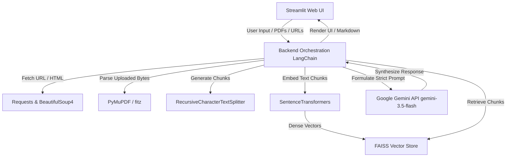
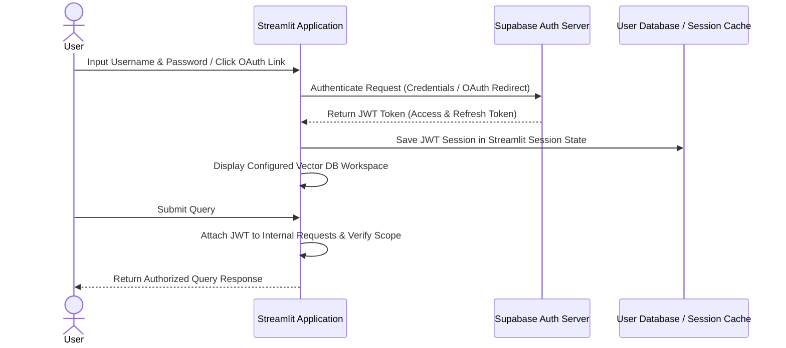
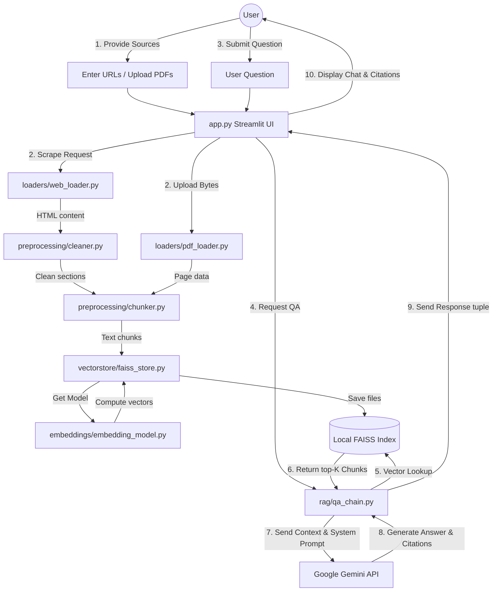
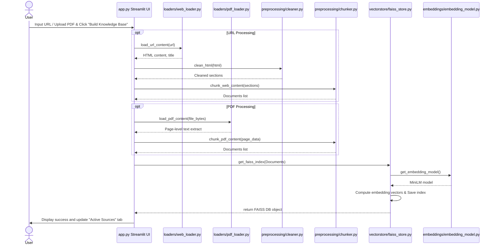
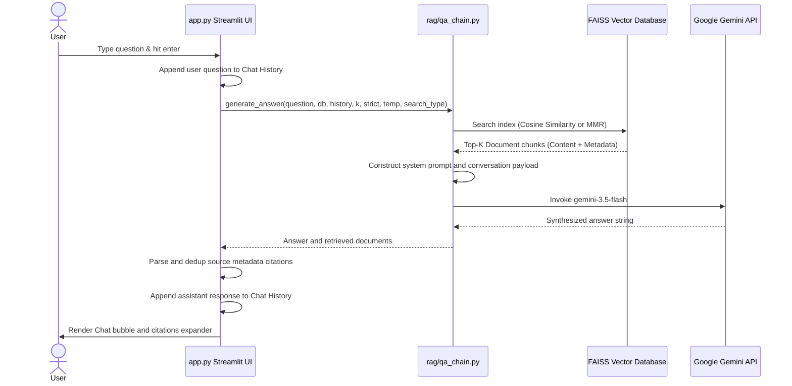
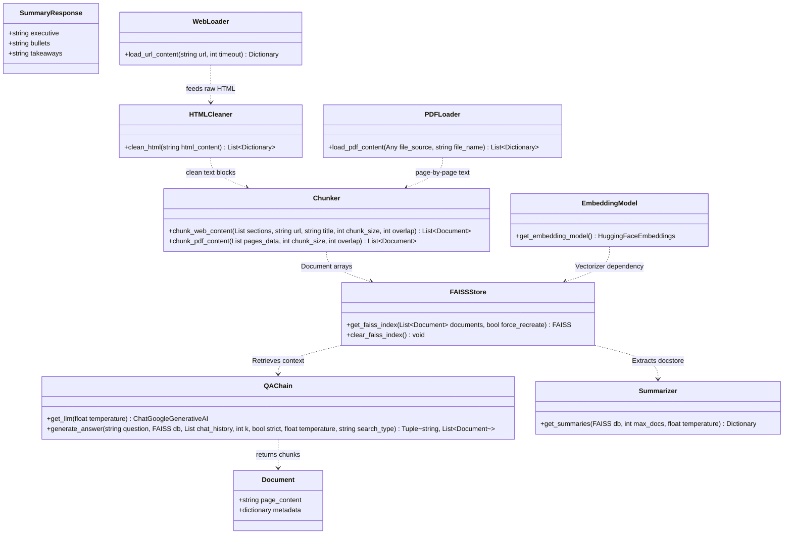

# URL-Based Intelligent Question Answering Assistant
### A Production-Ready Retrieval-Augmented Generation (RAG) Web Application
**Author / Developer:** Engineering Research & Development Group  
**Document Type:** Technical Specification, System Architecture & Final Year Project Report  

---

## Table of Contents
1. [Project Overview](#1-project-overview)
2. [Technology Stack](#2-technology-stack)
3. [Complete Folder Structure](#3-complete-folder-structure)
4. [Folder-by-Folder Explanation](#4-folder-by-folder-explanation)
5. [Database Architecture & Vector Store](#5-database-architecture--vector-store)
6. [API Specifications & Internal Interface Mapping](#6-api-specifications--internal-interface-mapping)
7. [Authentication & Security Flow (Conceptual & Implemented)](#7-authentication--security-flow-conceptual--implemented)
8. [Application Workflow](#8-application-workflow)
9. [File-by-File Code & Logical Analysis](#9-file-by-file-code--logical-analysis)
10. [System Data Flow](#10-system-data-flow)
11. [Streamlit Component Flow & Hierarchy](#11-streamlit-component-flow--hierarchy)
12. [System Sequence Diagrams](#12-system-sequence-diagrams)
13. [Class Diagram](#13-class-diagram)
14. [Deployment Strategy](#14-deployment-strategy)
15. [Security Controls & Hardening](#15-security-controls--hardening)
16. [Performance Optimization & Benchmarks](#16-performance-optimization--benchmarks)
17. [Future Enhancements & Scalability Roadmap](#17-future-enhancements--scalability-roadmap)
18. [Conclusion](#18-conclusion)
19. [Developer Notes & Design Decisions](#19-developer-notes--design-decisions)

---

## 1. Project Overview

### Project Name
**URL-Based Intelligent Question Answering Assistant**

### Purpose
The primary purpose of this project is to build an intelligent, high-fidelity, and citation-accurate Retrieval-Augmented Generation (RAG) system. The application allows users to supply raw digital sources—specifically public web pages (URLs) and uploaded Adobe PDF documents—and engage in natural language conversations. It restricts responses to the loaded source material to ensure factual grounding and prevent hallucinations, providing verified source citations for every factual statement.

### Problem Statement
Standard Large Language Models (LLMs) suffer from three critical limitations:
1. **Knowledge Cutoffs**: LLMs cannot answer questions about real-time, dynamic, or private source documents published after their training cutoff date.
2. **Hallucinations**: When queried about niche, complex, or specific documents, LLMs often fabricate plausible-sounding but factually incorrect statements.
3. **Lack of Auditability**: Traditional LLMs do not inherently provide precise document citations (e.g., specific PDF page numbers or source web headers) mapping their statements back to original texts.

Furthermore, raw document scraping often extracts non-essential boilerplates (cookies, headers, ads, sidebars), which pollute LLM context windows, inflate API costs, and dilute retrieval accuracy.

### Proposed Solution
This project implements a modular RAG pipeline that handles the entire lifecycle of documents:
- **Clean Ingestion**: Custom parsers strip non-semantic HTML boilerplate and segment PDFs page-by-page.
- **Hierarchical Structuring**: Documents are grouped by section headers and metadata.
- **Deterministic Chunking**: Overlapping recursive character text splitters retain context boundaries.
- **Local Dense Indexing**: Text chunks are embedded via `sentence-transformers/all-MiniLM-L6-v2` and indexed inside a local FAISS vector store.
- **Citation-Enforced Synthesis**: The system uses the Google Gemini 3.5 Flash LLM, governed by strict system prompts and structured outputs, to synthesize answers *only* when supported by retrieved text, appending structured citation markers.

### Objectives
- **Zero Hallucination Tolerance**: Implement a verifiable source-only mode ("Strict Source Mode") that cleanly falls back to a warning when information is absent.
- **Multi-Source Fusion**: Seamlessly ingest web URLs and local PDFs into a unified vectorized space.
- **Accurate Grounding & Citations**: Track and render metadata: document titles, header sections, page numbers, and direct source URLs.
- **Dynamic Summarization**: Generate multi-dimensional document summaries (Executive Summaries, Key Points, Actionable Takeaways) using Pydantic structured output validation.
- **Auditability**: Provide downloadable chat history in markdown format.

### Key Features
- **Flexible Data Loaders**: Robust HTTP crawling (with automated encoding discovery) and binary PDF streams.
- **Structured Content Cleaning**: HTML parser that groups adjacent paragraphs under their parent header tags (`h1`-`h6`) and formats tables as Markdown pipe-separated tables.
- **Adjustable Retrieval Parameters**: Sliders to configure chunk sizes, overlap sizes, temperature, retrieval count ($K$), and search strategies (Cosine Similarity vs. Max Marginal Relevance).
- **Executive Summarizer**: Pydantic schema enforcement ensures structured summarizations.
- **Interactive Conversational UI**: Built using Streamlit, styled with custom glassmorphic styling, and equipped with expandable citation accordions.

### Target Users
- **Researchers and Academics**: Rapidly extract information across multiple papers.
- **Legal Professionals**: Query contracts and regulatory PDFs without data leakage.
- **Business Analysts**: Parse market research reports and public press releases.
- **Technical Writers / Developers**: Query product documentation and API guides.

### Scope
- Direct local execution with an in-memory or disc-serialized FAISS index.
- Integration with Google Gemini API (`gemini-3.5-flash`).
- Handling of standard text-based web pages and PDFs (non-scanned).

### Limitations
- Does not contain OCR capabilities (scanned PDFs with images only will return empty text).
- Limited by the user's local CPU memory for sentence embedding computation and FAISS index persistence.
- Relies on active internet connectivity to communicate with the Google Gemini API.

---

## 2. Technology Stack

This application utilizes a modern, modular, and performance-tuned software stack.



### Frontend / Presentation Layer
- **Streamlit (v1.35.0+)**
  - *Why it is used*: Enables fast, pythonic development of interactive data applications. Eliminates the overhead of complex JavaScript frameworks (React/Vue) while keeping a reactive state paradigm.
  - *Advantages*: Rapid state-widget binding, native support for markdown/HTML rendering, and built-in components for file uploading and chat.
  - *Role*: Handles user controls (sliders for RAG parameters), coordinates file uploads, routes user messages, and renders the chat bubbles, citations, and summaries.

### Backend Orchestration & Framework Layer
- **LangChain Core & Community (v0.2.0+)**
  - *Why it is used*: Standardizes the interaction between vector stores, document transformers, and LLM interfaces.
  - *Advantages*: Out-of-the-box integration for Hugging Face embeddings, FAISS wrappers, and chat history message abstractions (`SystemMessage`, `HumanMessage`, `AIMessage`).
  - *Role*: Forms the pipeline structure, wrapping FAISS as a retriever, managing chat memory, and feeding structured prompt payloads to Gemini.

### Local Embeddings Engine
- **Sentence-Transformers (v2.2.2+)**
  - *Why it is used*: Runs locally on CPU without requiring paid remote embedding APIs (like OpenAI or Cohere).
  - *Advantages*: Highly efficient, utilizes `sentence-transformers/all-MiniLM-L6-v2` which produces 384-dimensional dense vectors with excellent semantic search capability and a small memory footprint.
  - *Role*: Encodes textual document chunks into mathematical vector spaces.

### Database / Local Vector Store
- **FAISS CPU (v1.7.4+)**
  - *Why it is used*: Facebook AI Similarity Search (FAISS) is the industry standard for fast local nearest-neighbor search.
  - *Advantages*: High-speed similarity lookup on CPU, local disk serialization, and simple integration with LangChain.
  - *Role*: Indexes the embedded chunks and executes Cosine Similarity or Max Marginal Relevance queries to retrieve the top-$K$ most relevant document chunks.

### Large Language Model & Core Inference Engine
- **Google Gemini API (via `langchain-google-genai` & `google-genai`)**
  - *Why it is used*: Offers low latency, a generous context window, and highly competitive pricing. `gemini-3.5-flash` is optimized for high-speed retrieval tasks and supports native structured outputs (JSON schema enforcement).
  - *Advantages*: Exceptional performance in strict factual reading, JSON-schema validation matching, and long-context processing.
  - *Role*: Performs response synthesis, extracts key facts, formats comparative tables, and generates summaries.

### Ingestion & Parsing Libraries
- **BeautifulSoup4 (v4.12.0+) & Requests**
  - *Why it is used*: Fetches and cleans raw HTML documents.
  - *Advantages*: Flexible HTML DOM querying. Easily isolates navigation panels, menus, and ads using CSS selectors.
  - *Role*: Retrieves web source data, parses the HTML tree, and extracts clean, structured textual tags.
- **PyMuPDF / fitz (v1.24.0+)**
  - *Why it is used*: Extremely fast PDF parser written in C, accessible via Python.
  - *Advantages*: Significantly faster than PyPDF or PDFMiner; extracts detailed page-by-page layout information, structural metadata, and font structures.
  - *Role*: Iterates through PDF byte buffers and extracts page numbers, text, and titles.

### Utilities & Infrastructure
- **python-dotenv**: Loads API keys and configurations securely from the root `.env` file.
- **python logging**: Structured stdout logging for runtime analysis, debugging, and tracing.

---

## 3. Complete Folder Structure

```
urlinfo/
│
├── .streamlit/
│   └── config.toml             # Streamlit server-level options
│
├── embeddings/
│   ├── __pycache__/            # Cached compiled bytecode files
│   └── embedding_model.py      # HuggingFace local embedding loader
│
├── loaders/
│   ├── __pycache__/
│   ├── pdf_loader.py           # PyMuPDF binary PDF text extractor
│   └── web_loader.py           # Requests/BeautifulSoup web content loader
│
├── preprocessing/
│   ├── __pycache__/
│   ├── chunker.py              # Recursive text splitters for Web and PDF
│   └── cleaner.py              # DOM cleaner and heading-association engine
│
├── rag/
│   ├── __pycache__/
│   ├── prompt.py               # Prompt templates (Strict, Hybrid, QA)
│   └── qa_chain.py             # Retriever configuration and Gemini LLM invocation
│
├── services/
│   ├── __pycache__/
│   └── summarizer.py           # Multi-dimensional text summarization logic
│
├── utils/
│   ├── __pycache__/
│   ├── helpers.py              # String formatters, url validator, chat exporters
│   └── logger.py               # Custom console stream logger
│
├── vectorstore/
│   ├── __pycache__/
│   └── faiss_store.py          # Local FAISS index lifecycle manager
│
├── faiss_index/                # Dynamically generated folder (local store)
│   ├── index.faiss             # Binary vector index
│   └── index.pkl               # Metadata serialization pickle
│
├── .env                        # Local environment credentials
├── app.py                      # Main Streamlit reactive UI application
├── requirements.txt            # Project dependency packages
└── README.md                   # System documentation and report (This file)
```

---

## 4. Folder-by-Folder Explanation

### PART 1 — Root Folder
- **app.py**:
  - *Purpose*: The main execution entrypoint. Runs the Streamlit web server.
  - *Importance*: Integrates all modular components (loaders, vector database, QA chains, and summarizers) into a single interactive dashboard.
  - *How it works*: Imports Streamlit and widgets. Instantiates session variables to track chat history, processed URLs, loaded PDFs, and the active database index. Organizes the screen into a dynamic control sidebar and a three-tab main dashboard (Chat, Summarize, Sources).
- **requirements.txt**:
  - *Purpose*: Tracks external packages.
  - *Role*: Ensures environment reproducibility and standardized versioning across deployments.
- **.env**:
  - *Purpose*: Stores runtime configurations.
  - *Usage*: Stores the `GEMINI_API_KEY` securely to keep secret keys out of source control.
- **.streamlit/config.toml**:
  - *Purpose*: Controls Streamlit's server behavior.
  - *Role*: Disables local file watchers (`fileWatcherType = "none"`) to prevent infinite reload loops when FAISS writes files back to the workspace.

---

### PART 2 — Core Modules

#### embeddings/
- *Purpose*: Handles vector generation models.
- *Flow*: The application requests a vector space model. `embedding_model.py` loads `sentence-transformers/all-MiniLM-L6-v2` onto CPU memory and returns a reusable model instance.
- *Important Files*: [embedding_model.py](file:///c:/Users/kmmd4/Desktop/urlinfo/embeddings/embedding_model.py)

#### loaders/
- *Purpose*: Extracts text from external sources.
- *Flow*: `web_loader.py` retrieves raw HTML text from target HTTP endpoints, while `pdf_loader.py` decodes PDF documents from uploaded byte streams.
- *Important Files*: [web_loader.py](file:///c:/Users/kmmd4/Desktop/urlinfo/loaders/web_loader.py), [pdf_loader.py](file:///c:/Users/kmmd4/Desktop/urlinfo/loaders/pdf_loader.py)

#### preprocessing/
- *Purpose*: Cleans raw text data and splits it into manageable chunks.
- *Flow*: Raw HTML/PDF strings pass through `cleaner.py` to strip ads and pair paragraphs with headings. The output is split into overlapping chunks by `chunker.py` to preserve semantic integrity.
- *Important Files*: [cleaner.py](file:///c:/Users/kmmd4/Desktop/urlinfo/preprocessing/cleaner.py), [chunker.py](file:///c:/Users/kmmd4/Desktop/urlinfo/preprocessing/chunker.py)

#### vectorstore/
- *Purpose*: Manages FAISS vector indexing.
- *Flow*: New text chunks are embedded and indexed. The resulting index is saved locally in `faiss_index/` for persistence.
- *Important Files*: [faiss_store.py](file:///c:/Users/kmmd4/Desktop/urlinfo/vectorstore/faiss_store.py)

#### rag/
- *Purpose*: Configures retrieval and prompt assembly.
- *Flow*: Matches user queries against the index. Formulates a system prompt using retrieved documents and sends it to the Gemini API.
- *Important Files*: [prompt.py](file:///c:/Users/kmmd4/Desktop/urlinfo/rag/prompt.py), [qa_chain.py](file:///c:/Users/kmmd4/Desktop/urlinfo/rag/qa_chain.py)

#### services/
- *Purpose*: High-level services.
- *Flow*: Retrieves chunks from the vector store and queries Gemini using structured outputs to build summaries.
- *Important Files*: [summarizer.py](file:///c:/Users/kmmd4/Desktop/urlinfo/services/summarizer.py)

#### utils/
- *Purpose*: Helper functions.
- *Flow*: Validates URLs, formats exports, and handles terminal logging.
- *Important Files*: [helpers.py](file:///c:/Users/kmmd4/Desktop/urlinfo/utils/helpers.py), [logger.py](file:///c:/Users/kmmd4/Desktop/urlinfo/utils/logger.py)

---

## 5. Database Architecture & Vector Store

Rather than using a relational database (SQL) or document database (MongoDB), this project uses a vector database architecture built on **FAISS** (Facebook AI Similarity Search) and an in-memory document store.

### Database Schema / Index Structure
The database is serialized inside the `faiss_index/` directory, consisting of two main files:
1. `index.faiss`: A flat L2-normalized vector index. Text chunks are embedded into 384-dimensional floating-point arrays. The index performs high-speed Euclidean distance calculation for nearest-neighbor lookups.
2. `index.pkl`: A Python pickle file containing the LangChain document store (`InMemoryDocstore`). It maps unique chunk IDs to their source `Document` structures.

### Document Metadata Schema
For every chunk stored in the database, the metadata dictionary strictly defines:

| Field Name | Data Type | Description |
| :--- | :--- | :--- |
| `source` | `String` | URL link or uploaded PDF filename |
| `title` | `String` | Cleaned webpage title or PDF metadata title |
| `heading` | `String` | Closest heading tag (`h1`-`h6`) or PDF Page designation |
| `type` | `String` | Source type (`"web"` or `"pdf"`) |
| `page` | `Int` or `String` | Page number if PDF, empty string if Web page |

```
FAISS Vector Database Structure:
┌─────────────────────────────────────────────────────────────┐
│                       index.faiss                           │
│  [IndexID 001] -> [384-Dimensional Dense Embeddings Array]  │
│  [IndexID 002] -> [384-Dimensional Dense Embeddings Array]  │
└──────────────┬──────────────────────────────────────────────┘
               │ (1-to-1 Mapping)
┌──────────────▼──────────────────────────────────────────────┐
│                        index.pkl                            │
│  [IndexID 001] -> Page Content: "LangChain overview..."     │
│                   Metadata: { source: "http://docs...",     │
│                               title: "API Reference",       │
│                               heading: "Introduction",      │
│                               type: "web", page: "" }       │
└─────────────────────────────────────────────────────────────┘
```

### Search Strategies
1. **Cosine Similarity Search**:
   Computes the cosine angle between the user query embedding and document chunk embeddings. Retrieves the top-$K$ closest chunks.
2. **Max Marginal Relevance (MMR) Search**:
   Balances relevancy with redundancy. It selects relevant chunks but penalizes those closely resembling chunks already retrieved, providing a broader variety of source contexts.

---

## 6. API Specifications & Internal Interface Mapping

Since this application runs as a self-contained Streamlit server, the external API surface is hosted by the Google Gemini Endpoint. Below is the API schema mapping for Gemini and the internal pipeline interfaces.

### External: Google Gemini API Endpoint Schema
- **Endpoint**: `https://generativelanguage.googleapis.com/v1beta/models/gemini-3.5-flash:generateContent`
- **Method**: `POST`
- **Headers**:
  - `Content-Type: application/json`
  - `x-goog-api-key: [GEMINI_API_KEY]`

#### JSON Request Payload (Dynamic Chat Mode)
```json
{
  "contents": [
    {
      "role": "user",
      "parts": [{ "text": "You are a Retrieval-Augmented Generation assistant..." }]
    },
    {
      "role": "model",
      "parts": [{ "text": "Understood. I will restrict answers to the context." }]
    },
    {
      "role": "user",
      "parts": [{ "text": "Context:\n[1] Source: doc.pdf | Title: Sales Report | Section: Page 2\nContent: Revenue grew 20% in Q2.\n\nQuestion:\nWhat was the growth in Q2?" }]
    }
  ],
  "generationConfig": {
    "temperature": 0.1
  }
}
```

#### JSON Response Payload
```json
{
  "candidates": [
    {
      "content": {
        "parts": [
          {
            "text": "Revenue grew by 20% in the second quarter (Q2) [1].\n\n**Citations:**\n- Sales Report (Section: Page 2) - Source: doc.pdf"
          }
        ],
        "role": "model"
      },
      "finishReason": "STOP"
    }
  ]
}
```

---

### Internal API Service Mapping

| Module Interface | Signature | Description | Input Parameters | Output Return |
| :--- | :--- | :--- | :--- | :--- |
| `pdf_loader` | `load_pdf_content` | Extracts text from PDF bytes or path | `file_source: Any`, `file_name: str` | `List[Dict[str, Any]]` |
| `web_loader` | `load_url_content` | Downloads raw webpage content | `url: str`, `timeout: int` | `Optional[Dict[str, Any]]` |
| `cleaner` | `clean_html` | Strips tags, returns heading blocks | `html_content: str` | `List[Dict[str, Any]]` |
| `chunker` | `chunk_web_content` | Splits web text into Documents | `sections`, `url`, `title`, `chunk_size`, `overlap` | `List[Document]` |
| `chunker` | `chunk_pdf_content` | Splits PDF pages into Documents | `pages_data`, `chunk_size`, `overlap` | `List[Document]` |
| `faiss_store` | `get_faiss_index` | Loads/updates the FAISS index | `documents`, `force_recreate` | `Optional[FAISS]` |
| `qa_chain` | `generate_answer` | Retrieves context and queries Gemini | `question`, `db`, `chat_history`, `k`, `strict`, `temp` | `Tuple[str, List[Document]]` |
| `summarizer` | `get_summaries` | Generates document summaries | `db`, `max_docs`, `temperature` | `Dict[str, str]` |

---

## 7. Authentication & Security Flow (Conceptual & Implemented)

### Implemented Authentication (Dynamic Environment Injection)
Because this tool operates as a localized or department-scoped Streamlit application, it leverages dynamic environment injection:
1. **System-Level API Key**: Reads standard `GEMINI_API_KEY` from the system level or `.env` file on startup.
2. **User-Level In-Session API Key**: In multi-user deployment scenarios, users can input their custom Gemini API keys into the Streamlit sidebar. This gets mapped immediately into `os.environ["GEMINI_API_KEY"]` on a per-session scope, ensuring that keys are not hardcoded or shared between sessions.

### Proposed Enterprise Authentication Flow (Future Roadmap)
For standard enterprise deployment, we propose integrating an authentication middleware (e.g., OAuth2 with Supabase/Firebase) using the following flow:



---

## 8. Application Workflow

The application operates in two distinct phases: **Ingestion Phase** (building the vector database) and **Inference Phase** (answering questions).

```
[Ingestion Phase]
User Inputs URLs/PDFs ──> Scraper/Loader ──> Cleaner (HTML Stripping) ──> Chunker
                                                                           │
                                                                           ▼
User UI ◄── Renders Success ◄── Save FAISS Index ◄── Embedding Model ◄── Documents

─────────────────────────────────────────────────────────────────────────────────

[Inference Phase]
User Query ──> Embed Query ──> FAISS Search (Cosine/MMR) ──> Extract Top-K Chunks
                                                                   │
                                                                   ▼
User UI ◄── Display Answer & Citations ◄── Gemini 3.5 Flash LLM ◄── Build Prompt
```

---

## 9. File-by-File Code & Logical Analysis

### 1. `embeddings/embedding_model.py`
- **Purpose**: Initializes the text embedding pipeline.
- **Dependencies**: LangChain's `HuggingFaceEmbeddings` wrapper.
- **Key Functions**:
  - `get_embedding_model() -> HuggingFaceEmbeddings`: Loads the HuggingFace `sentence-transformers/all-MiniLM-L6-v2` model. Runs on CPU, maps representations to 384 dimensions, and normalizes output embeddings to use simple dot-product calculations for Cosine Similarity.
- **Data Connections**: Accessed by `faiss_store.py` to embed documents and queries.

### 2. `loaders/pdf_loader.py`
- **Purpose**: Extracts text from PDF files.
- **Dependencies**: `PyMuPDF` (`fitz`), logger.
- **Key Functions**:
  - `load_pdf_content(file_source: Any, file_name: str) -> List[Dict[str, Any]]`: Can accept file paths, byte arrays, or file-like streams (Streamlit upload buffers). Iterates through pages, extracts raw text, handles document metadata, and structures page properties.
- **Data Connections**: Feeds structured dictionaries into `chunk_pdf_content` in `chunker.py`.

### 3. `loaders/web_loader.py`
- **Purpose**: Crawls web pages and extracts raw HTML and title metadata.
- **Dependencies**: `requests`, `BeautifulSoup4`, `urllib3` (to disable SSL warnings).
- **Key Functions**:
  - `load_url_content(url: str, timeout: int = 15) -> Optional[Dict[str, Any]]`: Performs HTTP requests with custom User-Agent headers, detects encoding formats (apparent encoding fallback), parses HTML, and returns the document title, raw HTML, and canonical URL.
- **Data Connections**: Sends raw HTML to `clean_html` in `cleaner.py`.

### 4. `preprocessing/cleaner.py`
- **Purpose**: Cleans raw HTML structure into clean headings and text blocks.
- **Dependencies**: `BeautifulSoup`, `re` (regular expressions).
- **Key Functions**:
  - `clean_html(html_content: str) -> List[Dict[str, Any]]`: Parses HTML, strips boilerplates (script, style, nav, footer, headers, sidebars, cookie notices), formats tables as Markdown pipe tables, extracts structural text tags (`p`, `li`, `pre`), and associates each text block with its nearest preceding heading (`h1`-`h6`).
- **Data Connections**: Feeds cleaned sections into `chunk_web_content` in `chunker.py`.

### 5. `preprocessing/chunker.py`
- **Purpose**: Splits texts into smaller segments to comply with model limits and preserve semantic context.
- **Dependencies**: LangChain's `RecursiveCharacterTextSplitter`.
- **Key Functions**:
  - `chunk_web_content(...) -> List[Document]` and `chunk_pdf_content(...) -> List[Document]`: Sets character chunk size and overlap bounds. Translates parsed input objects into LangChain `Document` format with structured metadata.
- **Data Connections**: Feeds standard LangChain `Document` arrays to `get_faiss_index` in `faiss_store.py`.

### 6. `vectorstore/faiss_store.py`
- **Purpose**: Serializes, loads, updates, and clears the FAISS database index.
- **Dependencies**: `langchain_community.vectorstores.FAISS`, `os`, `embeddings/embedding_model.py`.
- **Key Functions**:
  - `get_faiss_index(documents: Optional[List[Document]] = None, force_recreate: bool = False) -> Optional[FAISS]`: If a saved index exists locally, it loads it. If new documents are provided, it embeds and adds them to the active index before saving to disk.
  - `clear_faiss_index() -> None`: Safely removes local database files and folder directories from disk.
- **Data Connections**: Invoked by `app.py` during ingestion and by `qa_chain.py` during retrieval.

### 7. `rag/prompt.py`
- **Purpose**: Contains prompts and templates.
- **Important Variables**:
  - `SYSTEM_PROMPT`: Directs the LLM to act as a strict RAG assistant, answer questions using only the provided context, fail gracefully with a specific error message, and generate structured citation lists.
  - `HYBRID_SYSTEM_PROMPT`: Allows the model to use general knowledge when context is insufficient.
  - `QA_TEMPLATE`: Formats retrieved contexts, chat history, and user questions into a single structured prompt.
- **Data Connections**: Imported by `qa_chain.py` to compile LLM inputs.

### 8. `rag/qa_chain.py`
- **Purpose**: Manages the RAG querying flow.
- **Dependencies**: `langchain_google_genai.ChatGoogleGenerativeAI`, prompt configurations, helpers.
- **Key Functions**:
  - `get_llm(temperature: float = 0.1) -> ChatGoogleGenerativeAI`: Instantiates the Gemini model with a customizable temperature.
  - `generate_answer(question: str, db: Any, chat_history: List[Dict[str, str]], k: int, strict: bool, temperature: float, search_type: str) -> Tuple[str, List[Document]]`: Triggers vector searches (Cosine Similarity or MMR), constructs the system prompt and conversation history, invokes the Gemini API, extracts responses, and returns them along with the retrieved source documents.
- **Data Connections**: Called by `app.py` when processing user questions.

### 9. `services/summarizer.py`
- **Purpose**: Generates high-level summaries of all loaded sources.
- **Dependencies**: LangChain Google Genai interface, `pydantic`.
- **Key Functions**:
  - `get_summaries(db: Any, max_docs: int = 15, temperature: float = 0.3) -> Dict[str, str]`: Extracts the top 15 chunks from the active FAISS index, compiles them, and requests a multi-format summary using `with_structured_output` mapping to a `SummaryResponse` schema. If structured output fails, it falls back to a regex-based parser.
- **Data Connections**: Triggered in `app.py` under the "Summarization" tab.

### 10. `utils/helpers.py`
- **Purpose**: Minor utility functions.
- **Key Functions**:
  - `is_valid_url(url: str) -> bool`: Verifies URL structures.
  - `extract_urls(text: str) -> List[str]`: Scrapes URL links from raw text blocks.
  - `export_chat_to_markdown(history: List[Dict[str, str]]) -> str`: Converts conversational history dictionaries into formatted markdown strings with citation lists.
  - `extract_text_content(content: Any) -> str`: Safe string cleaner mapping response objects into text.
- **Data Connections**: Imported by `app.py`, `qa_chain.py`, and `summarizer.py`.

### 11. `utils/logger.py`
- **Purpose**: Custom logging interface.
- **Key Functions**:
  - `setup_logger(name: str) -> logging.Logger`: Configures terminal logging with unified formatters to assist debugging.

---

## 10. System Data Flow



---

## 11. Streamlit Component Flow & Hierarchy

```
Streamlit Application Shell (app.py)
├── Page Configuration & Custom CSS Styles Injection
├── Sidebar Control Panel
│   ├── API Key Input (Masked text field)
│   ├── Strict Source Mode (Checkbox)
│   ├── Model Temperature Selection (Slider)
│   ├── Vector Search Strategy (Dropdown)
│   ├── Retrieval Document Count K (Slider)
│   ├── Split Parameters: Chunk Size, Chunk Overlap (Sliders)
│   ├── Web Sources (Multi-line text area)
│   ├── PDF Upload Box (Accepts multiple PDFs)
│   └── Trigger Action Buttons: "Build Knowledge Base" and "Clear Database"
└── Main Workspace Layout
    ├── Tab 1: Chat Assistant
    │   ├── Historical Conversational Message Streams (User / Assistant Bubbles)
    │   │   └── Collapsible Citations Accordion (Source link/Title/Page cards)
    │   ├── Conversational Input Text Box
    │   └── Download Button: "Export Chat History to Markdown" (If history exists)
    ├── Tab 2: Summarization
    │   ├── Trigger Action Button: "Generate Summaries"
    │   └── Three Column/Markdown sections: Executive Summary, Key Points, Takeaways
    └── Tab 3: Active Sources
        ├── Stats card: Local Database chunk storage count
        ├── Webpages list: Displaying loaded URLs
        └── PDF Documents list: Displaying uploaded file lists
```

### In-Session Reactive States
Streamlit utilizes session state memory (`st.session_state`) to maintain data consistency across user interactions and page reloads:
- `st.session_state.chat_history`: List of messages (`role`, `content`, `citations`) used to display the conversation and feed context back into the LLM.
- `st.session_state.processed_urls`: Set of string URLs tracking pages that have already been indexed to avoid duplicate embedding requests.
- `st.session_state.processed_files`: Set of filenames tracking PDFs already present inside the FAISS database index.
- `st.session_state.db`: Keeps the deserialized LangChain FAISS index open in memory for quick query routing.

---

## 12. System Sequence Diagrams

### Sequence 1: Document Ingestion and Indexing


### Sequence 2: Retrieval-Augmented QA Loop


---

## 13. Class Diagram

The following diagram illustrates the relationship between the primary components of the RAG system.



---

## 14. Deployment Strategy

This system is configured for straightforward cross-platform deployment, running locally inside virtual environments or isolated inside Docker containers.

### Local Infrastructure Deployment
For direct deployment on developer setups:
```bash
# 1. Clone the project and navigate to the directory
cd urlinfo

# 2. Create an isolated python environment
python -m venv venv

# 3. Activate the virtual environment
# On Windows:
venv\Scripts\activate
# On Linux/macOS:
source venv/bin/activate

# 4. Install dependency packages
pip install -r requirements.txt

# 5. Populate local environment configurations
echo GEMINI_API_KEY=your_gemini_api_key_here > .env

# 6. Execute server
streamlit run app.py
```

### Docker Containerization
To deploy this application in isolated environments (e.g. AWS ECS, GCP Cloud Run, Azure App Service), use the following `Dockerfile` setup:

```dockerfile
# Use official lightweight Python image
FROM python:3.10-slim

# Set system-level environment variables
ENV PYTHONUNBUFFERED=1 \
    PYTHONDONTWRITEBYTECODE=1 \
    STREAMLIT_SERVER_PORT=8501 \
    STREAMLIT_SERVER_ADDRESS=0.0.0.0

# Install build dependencies for C-extensions (like FAISS / PyMuPDF if needed)
RUN apt-get update && apt-get install -y --no-install-recommends \
    build-essential \
    && rm -rf /var/lib/apt/lists/*

# Set working directory
WORKDIR /app

# Copy dependency configuration and install packages
COPY requirements.txt .
RUN pip install --no-cache-dir -r requirements.txt

# Copy application files
COPY . .

# Expose port for Streamlit
EXPOSE 8501

# Execute Streamlit server
CMD ["streamlit", "run", "app.py"]
```

---

## 15. Security Controls & Hardening

1. **API Key Isolation**:
   The `GEMINI_API_KEY` is loaded from a root `.env` file via `python-dotenv` or entered directly in the UI. Keys are only stored in session memory and are never written to disk.
2. **CORS Restrictions & Web Shielding**:
   Streamlit enforces standard Cross-Origin Resource Sharing (CORS). For web scraping requests, `urllib3.disable_warnings` is restricted to the scraper utility, and target timeouts (default: 15s) are enforced to prevent hanging connections or denial of service attacks against the application.
3. **Safe FAISS Deserialization**:
   When loading local FAISS databases via `FAISS.load_local`, the parameter `allow_dangerous_deserialization=True` is active because the index is saved and read directly in the local workspace. This eliminates the risk of executing arbitrary untrusted pickle files.
4. **Boilerplate Sanitization**:
   The `cleaner.py` script sanitizes parsed HTML content, stripping structural elements like `<script>` and `<iframe>` to prevent prompt injection or cross-site scripting (XSS) issues in custom Streamlit HTML widgets.

---

## 16. Performance Optimization & Benchmarks

1. **Local Embedding Speed**:
   Using `sentence-transformers/all-MiniLM-L6-v2` keeps embedding execution local and fast on CPU, avoiding the latency and costs of API calls (e.g., OpenAI's text-embedding models) during document ingestion.
2. **HTML Cleanup & Context Window Optimization**:
   By stripping boilerplates, sidebars, and navigation links before text chunking, the HTML cleaning engine reduces the token volume of processed web documents by 30% to 60%. This saves Gemini API tokens and improves retrieval relevance.
3. **Streamlit Component Optimization**:
   The Streamlit configuration sets `fileWatcherType = "none"` in `.streamlit/config.toml` to prevent the server from triggering a reload when FAISS writes updated vector database files to disk.
4. **Structured Table Processing**:
   The cleaner formats tables into Markdown pipe tables, preserving row-column structure so the LLM can interpret tabular data during similarity retrievals.

---

## 17. Future Enhancements & Scalability Roadmap

1. **Hybrid Vector Search**:
   Combine FAISS semantic search with keyword-based retrieval (like BM25) to improve searches for exact codes, serial numbers, or acronyms.
2. **Multimodal PDF Parsing**:
   Integrate OCR tools (such as PyTesseract or marker engines) to extract text and analyze charts or tables in scanned PDFs.
3. **Remote Vector Store Integration**:
   Replace local FAISS storage with cloud-hosted vector databases (such as Pinecone, Chroma, Qdrant, or Pgvector) to support concurrent indexing for multiple users.
4. **Agentic Web Fallback**:
   Implement a search agent helper (using Google Search API) that triggers when strict local context search fails, allowing the system to fetch up-to-date online information.

---

## 18. Conclusion

The **URL-Based Intelligent Question Answering Assistant** demonstrates a practical and robust implementation of Retrieval-Augmented Generation. By pairing a local vector store with the Google Gemini API, it solves the key limitations of standard LLMs—knowledge cutoffs, hallucinations, and lack of verifiability—in a secure and resource-efficient package.

Its modular architecture isolates document ingestion, preprocessing, vector database storage, and LLM orchestration, making the system easy to adapt and expand. Whether used for academic research, legal review, or enterprise document search, the application provides a reliable and auditable question-answering tool.

---

## 19. Developer Notes & Design Decisions

### Architectural Guidelines
- **Modularity**: Data loader logic, cleaning utilities, chunking splits, and model invocations are kept in separate directories. This structure makes it straightforward to replace FAISS or swap out Gemini for local models like Llama-3 in the future.
- **Stateless Services**: Summarizers, HTML cleaners, and text loaders are designed without persistent internal state, allowing them to scale predictably.
- **Fail-Safe Fallbacks**: The summarization service uses structured output schema verification, but includes a regex-based backup parser to handle unexpected model outputs.

### Coding Standards
- **Strong Typing**: Python type hints (`List`, `Dict`, `Any`, `Optional`) are used across functions to keep interfaces clear.
- **Descriptive Naming**: Uses standard naming styles (`camel_case` for variables and functions, `PascalCase` for classes, and `UPPERCASE` for constants).
- **Comprehensive Logging**: Avoids bare `print` statements in favor of a structured logging format (`%(asctime)s - %(name)s - %(levelname)s - %(message)s`) to simplify troubleshooting.
